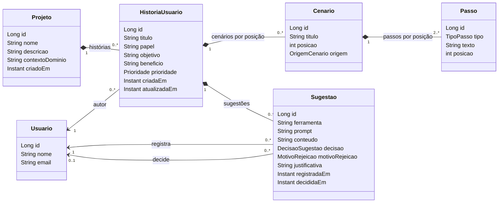

# Modelo de classes

Versão em PDF para apresentação: [diagrama-classes.pdf](diagrama-classes.pdf).

O domínio do Estúdio BDD usa as seis entidades do enunciado. As histórias registram requisitos de um projeto, e os cenários descrevem seus critérios de aceite. As sugestões conservam o conteúdo recebido da IA e as decisões tomadas pelos usuários.

## Valores do domínio

| Enum | Valores |
| --- | --- |
| `Prioridade` | `ALTA`, `MEDIA`, `BAIXA` |
| `OrigemCenario` | `HUMANO`, `SUGESTAO_IA` |
| `TipoPasso` | `DADO`, `QUANDO`, `ENTAO`, `E`, `MAS` |
| `DecisaoSugestao` | `PENDENTE`, `ACEITA`, `REJEITADA` |
| `MotivoRejeicao` | `INCORRETA`, `GENERICA`, `DUPLICADA`, `FORA_DO_ESCOPO`, `OUTRO` |

## Decisões de modelagem

- O projeto é a unidade de organização das histórias. O nome do projeto e o e-mail do usuário são únicos. A unicidade do título considera o projeto para histórias e a história para cenários.
- Cenários e passos guardam posições explícitas para conservar a ordem na edição, na consulta e na exportação. Um cenário persistido precisa de pelo menos dois passos, com `QUANDO` e `ENTAO`.
- As setas para `Usuario` representam referências de autoria e auditoria. A sugestão tem um usuário que a registra e recebe um segundo vínculo quando alguém a decide. Uma decisão registra quem a tomou, quando e com qual justificativa. A rejeição também exige um motivo do domínio.
- O serviço valida autoria e consistência antes da persistência. A remoção de um projeto também verifica a autoria das histórias que seriam excluídas com ele. As restrições e chaves estrangeiras no banco preservam a integridade das relações.
- O exportador monta o texto Gherkin com a narrativa da história e os cenários na ordem dos passos. A origem distingue cenários humanos de cenários que o analista cadastrou ou adaptou a partir de uma sugestão aceita.

## Cadastro de um cenário pelas cinco camadas

1. A SPA obtém o título, a origem e os passos em ordem, então envia o JSON para a API com a identidade selecionada.
2. O controlador recebe o DTO e aplica Bean Validation aos dados de entrada. O identificador da história vem da URL.
3. O serviço abre a transação, localiza a história, confirma a autoria e valida título e gramática dos passos.
4. O domínio representa o cenário ligado à história e define os passos com suas posições.
5. O repositório persiste a mudança com Spring Data JPA. O controlador retorna a representação criada em JSON.

As associações usam carregamento `LAZY`. As coleções `@OneToMany` seguem o padrão de JPA, e as referências `@ManyToOne` declaram essa estratégia explicitamente. O serviço consulta as associações dentro da transação e monta os DTOs com os campos que cada operação precisa. `@OrderBy` lê cenários e passos pela posição persistida, e `orphanRemoval` remove os passos retirados da composição.
